<p align="center">
  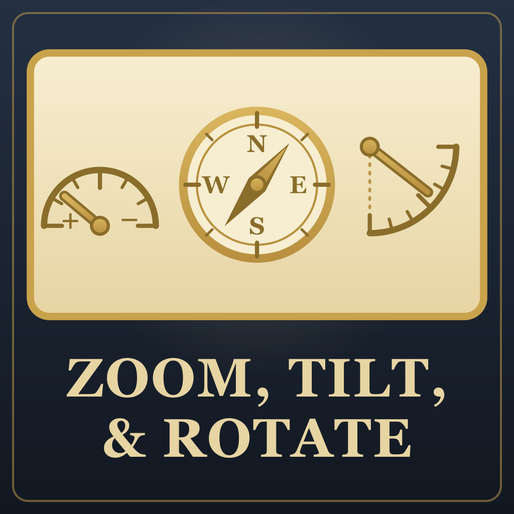
</p>

# Zoom, Tilt, & Rotate

A Civilization VII mod that lets you control the camera's zoom (how close or far it is), angle (how steeply it looks
down) and direction (which way it faces).

- **Zoom.** Keep scrolling in past the base game's standard closest view and the lens narrows until a unit fills the
  screen, up to 36 times closer than the game (you set max zoom in the settings). Keep scrolling out past the
  farthest view and the camera widens and turns to look straight down until most of the map fits on one screen.
- **Angle.** Tip the camera anywhere from straight down to nearly level with the horizon. It stays there.
- **Direction.** Turn the view to face north, east, south, west or anything in between. It stays facing that way
  until you turn it again.

A camera panel by the minimap shows all three as a zoom gauge, a compass and an angle gauge. Drag a gauge or its
slider to set it. The same three gauges can also sit on screen at the top left (turn them on in Options). Angle,
direction, Back to normal and the panel have hotkeys, and you can change them in Options.

**Back to normal**, a button on the panel or Shift + 0, faces north, goes back to the game's angle and returns the
zoom to the game's normal range.

- **Panning** moves the map at the same speed on screen however far in or out you are, and when the view is turned,
  the arrow keys still move it left, right, up and down as you see it.
- **The buy-tile and place-building screens** show the city the way the game normally does, then put your view back
  when you close them.

Use the mouse wheel, a trackpad, the keyboard, a gamepad or touch. The text is translated into 12 languages.

<p>
  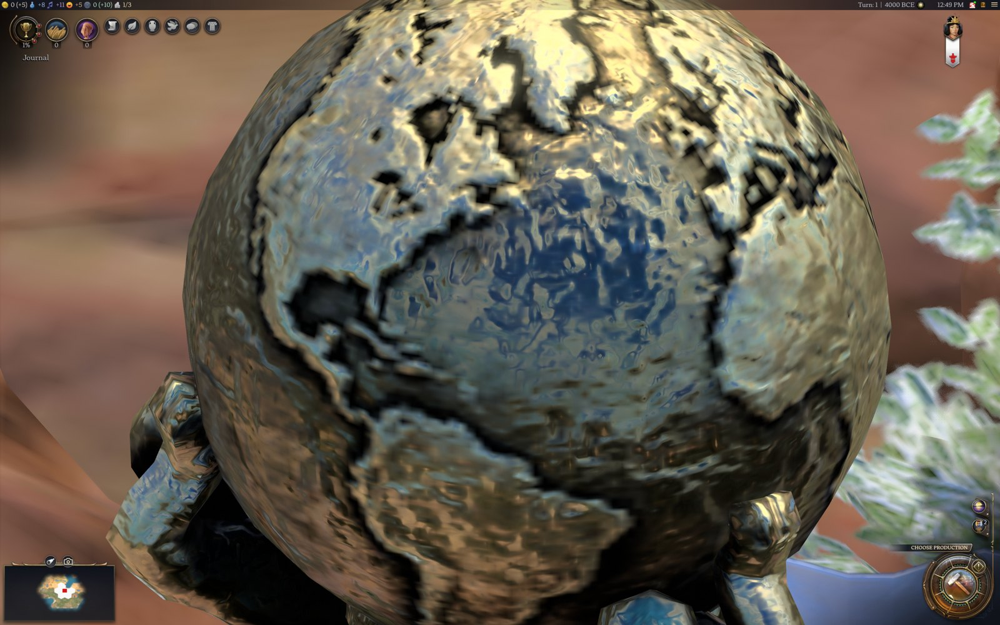
  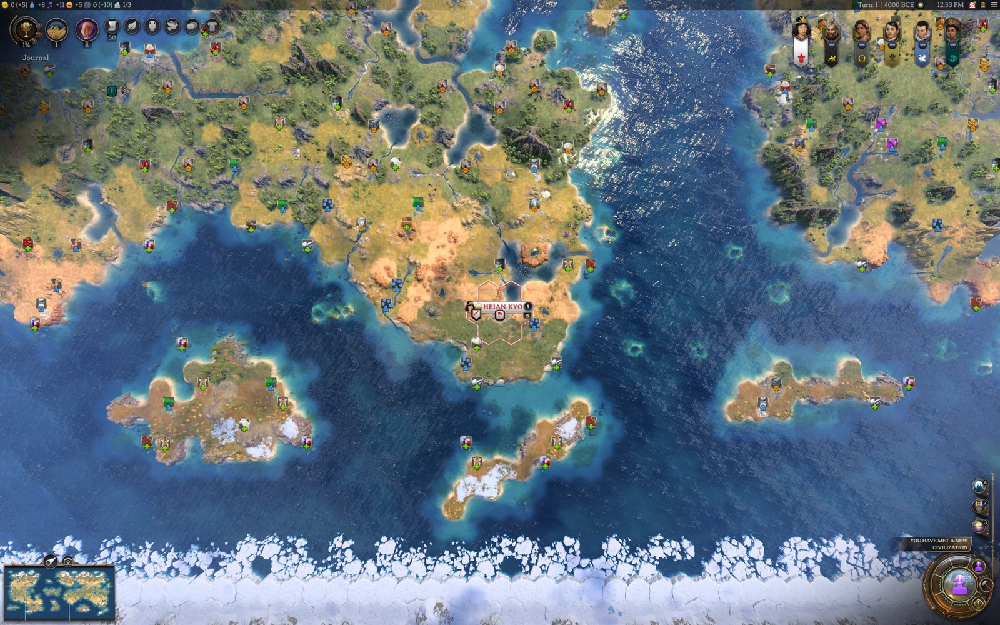
</p>

Screenshots are from Civilization VII 1.5.0 with every other mod off. The two far-out views have the map revealed.

---

## Using it

### Zoom

Zoom with the mouse wheel, a two-finger scroll on a trackpad, the gamepad triggers, or a pinch on a touch screen.

- **Zooming in past the limit** narrows the field of view from the game's 35 degrees. Set how far in Options >
  Add-ons > Zoom, Tilt, & Rotate > "How close you can zoom in":

  | Setting | Lens at the last notch | Compared with the game's closest view | What you see |
  | --- | --- | --- | --- |
  | Closer (7x), the default | 5 degrees | 7.2 times closer | A unit up close, models sharp |
  | Much closer (18x) | 2 degrees | 18 times closer | A unit fills the screen; the ground starts to go soft |
  | All the way (36x) | 1 degree | 36 times closer | A single sword blade; the ground is a blur |

  Either way it takes six notches, each magnifying by the same amount. A change takes effect immediately, even while
  you're zoomed in, and is saved between games.

<p>
  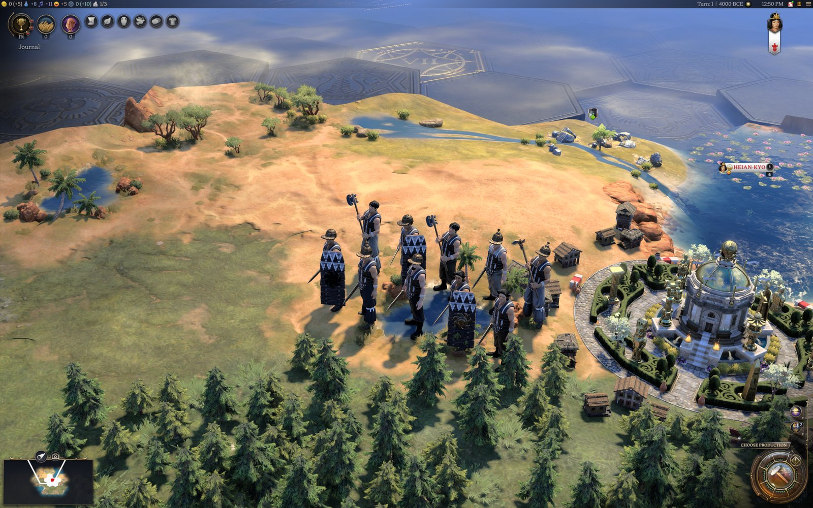
  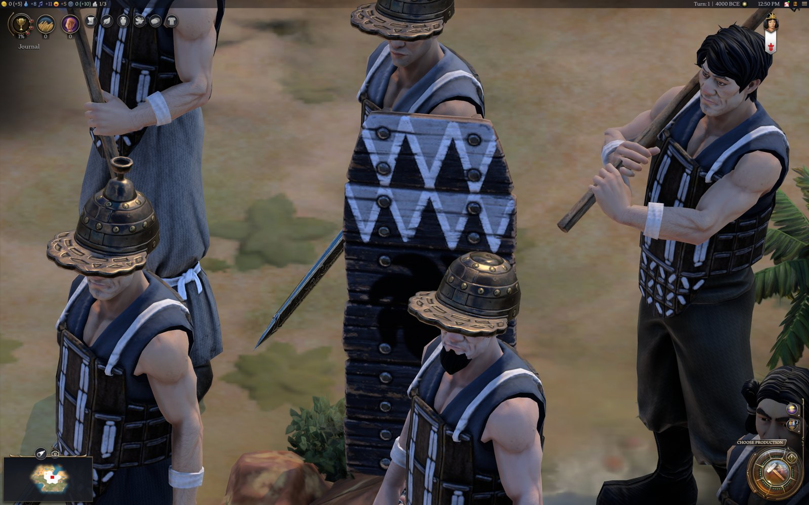
</p>

  The game's closest view (left) and the default close-up of the same soldiers (right).

- **Zooming out past the limit** widens the field of view to 90 degrees while the camera turns to look straight
  down. That's also six notches. The angle turns along with the lens, so the two arrive together however fast you
  scroll.
- **Keeping your angle far out.** Tick "Keep the angle when zoomed far out" in Options > Add-ons > Zoom, Tilt, &
  Rotate and the camera keeps its angle instead of turning straight down. It only tips down as far as it needs to
  keep the sky off the screen. At the game's own angle that's not at all, and you see the map in perspective out to
  its far edge.

<p>
  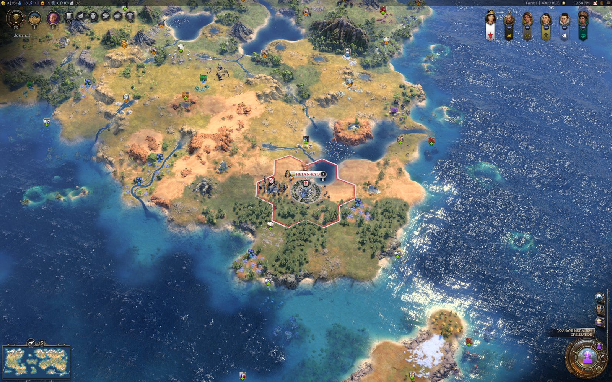
  
</p>

  The game's farthest view (left) and six notches past it (right).

- **Scrolling back** from past either limit moves back one notch at a time instead of snapping to the game's view.
- **On a trackpad**, zooming stops when your fingers stop, and lifting them doesn't zoom you back out.
- **City screens.** The buy-tile and place-building screens show the city the way the game normally does, even if
  you opened them from a close-up. Closing the screen puts your view back where it was.
- **The game moving the camera.** When the game moves the camera to a new zoom (a notification, a tutorial step),
  the game's own lens comes back as the camera arrives. When it moves the camera without changing the zoom (jumping
  to your next unit), you stay in the close-up you picked.

### Angle and direction

- **Angle** runs from straight down (0 degrees) to nearly level with the horizon (80 degrees). Until you change it,
  the camera uses the game's own angle, which shifts as you zoom.
- **Direction** stays where you set it through zooming, panning, city screens and the game moving the camera.
- **Tap or hold.** A tap moves one step and lands on a round number, so north, east, south and west are each one tap
  away. Holding the key or button turns or tips the camera smoothly until you let go. Set the step sizes in Options:
  the turn step (45 or 90 degrees) and the angle step (5, 10 or 15 degrees).
- **The game's own rotate still works.** Holding Alt (Option on a Mac) and dragging turns the view until you let go,
  then it swings back to north, as in the unmodded game. The panel and gauges follow it.
- **Panning follows the screen.** With the view turned, the arrow keys, the screen edge and a gamepad still move the
  map left, right, up and down as you see it.
- **Map icons at your angle.** Once you tip or zoom the camera past what the game does, the resource icons get
  smaller with distance, the way the yield icons already do, so the far side of the map doesn't turn into a wall of
  icons. The ones in the middle of the screen stay the size the game draws them. Back at the game's own angle you
  get the game's icons again.
- Every change eases in over about half a second.

<p>
  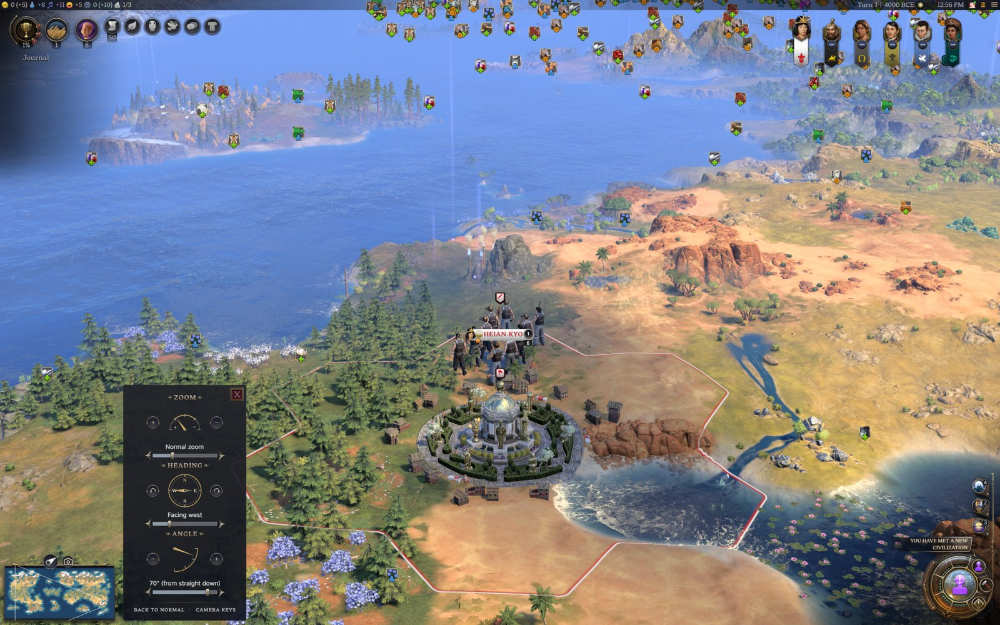
  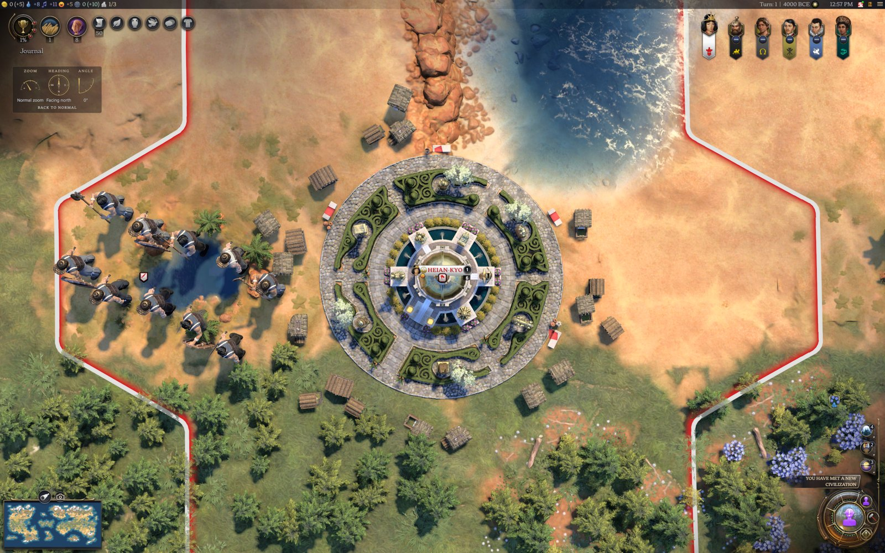
</p>

Tipped toward the horizon and facing west (left), and looking straight down with the gauges on screen (right).

Default keys:

| Keys | What they do |
| --- | --- |
| Shift + Up / Shift + Down | Angle toward the horizon / toward straight down |
| Shift + Left / Shift + Right | Turn left / right |
| Shift + 0 | Back to normal |
| Shift + C | Open or close the camera panel |

Change any of them in Options > Add-ons > Zoom, Tilt, & Rotate > Camera keys: press Change, then the keys you want,
holding any of Ctrl, Alt (Option on a Mac) and Shift. Esc cancels. If the combination is already used by another action,
it moves to the new one.

The **camera panel** opens from the camera button next to the minimap's lens button, or with Shift + C. It has:

- a zoom gauge covering the whole range, including the close-up and far-out notches
- a compass showing which way the view faces
- an angle gauge showing how far the camera tips

Each gauge has a button on either side (click to step, hold to keep going) and a slider underneath, and you can drag
the gauge itself. Below them are the minimap's Resources and Yields checkboxes, for a clear view of the land, then
Back to normal and Camera keys, which lists the keys and lets you change them. The
panel uses the game's own panel style and opens beside the minimap like the lens panel.

<p>
  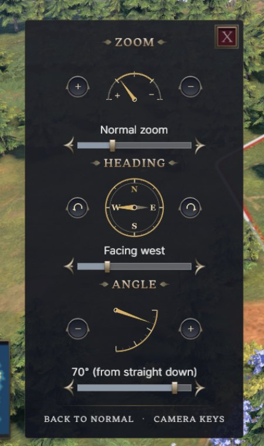
  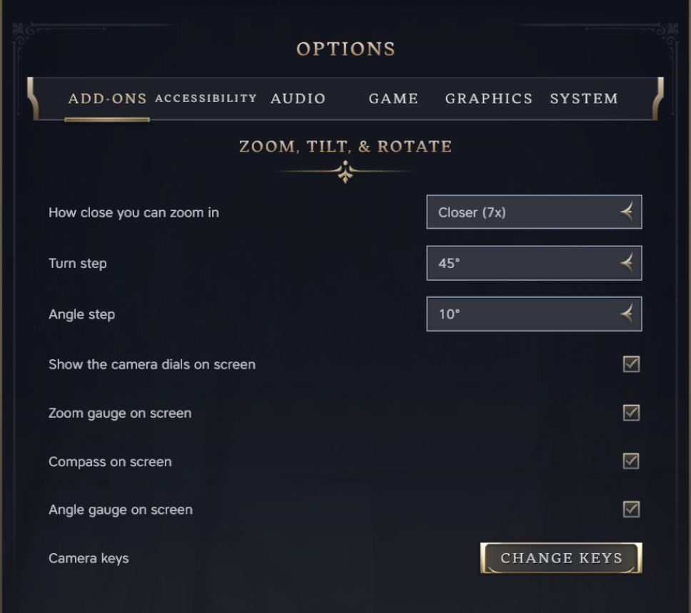 Add-ons" width="37%">
  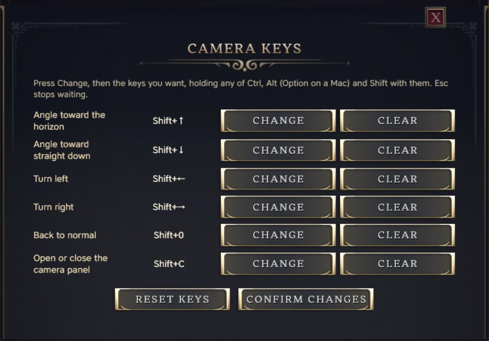
</p>

**Gauges on screen.** Turn on "Show the camera dials on screen" in Options to keep the zoom gauge, compass and angle
gauge at the top left of the screen, below the victories, journal and quest list. Each one has its own option to hide
it. You can drag them to set the camera, and they hide while a screen or popup is open.

## Why another zoom mod

Before building this, I tested the zoom mods already on the Workshop. The closest any of them got was about 2.3 times
closer than the game, one let go of its close-up after a few seconds, and neither let you set the camera angle or keep a
heading other than north. One of them put this down to the engine: that it forces the close-up to snap back, and that it
can't report or set a heading.

So I measured what the engine actually does. It holds a narrow lens for as long as you like, accepts a field of view
from 1 to 120 degrees, and reports and holds any heading and any angle from straight down to 80 degrees. That's the room
this mod works in: up to 36 times closer than the game (7 times by default; you can change it in Options), out until the
camera looks straight down, and any angle and direction you like.

The measurements, side by side with the other mods (not named), are in
[docs/compared-with-other-zoom-mods.md](docs/compared-with-other-zoom-mods.md).

## Install

Subscribe on the Steam Workshop, or download `zoom-tilt-rotate-vX.Y.Z.zip` from the GitHub releases and unzip it into
the game's `Mods` directory, so the `zoom-tilt-rotate` folder sits directly inside it. Then enable Zoom, Tilt, &
Rotate in the game's mod settings. Your saves aren't touched, so you can turn it on or off at any time.

The `Mods` directory is `%LOCALAPPDATA%\Firaxis Games\Sid Meier's Civilization VII\Mods` on Windows and
`~/Library/Application Support/Civilization VII/Mods` on a Mac.

Made for Civilization VII 1.5.0. The text is in English, German, Spanish, French, Italian, Japanese, Korean, Polish,
Portuguese (Brazil), Russian and Chinese (Simplified and Traditional), following the game's language setting.

## Known limits

- It's been played with a Mac trackpad and keyboard. The mouse wheel was tested with input sent through macOS, and
  the gamepad and touch screen with input sent through the game, but none of them on real hardware yet.
- On a Mac trackpad, zoom with a two-finger scroll. A pinch hasn't zoomed the game in testing.
- In the close-up the game's yield badges keep their full size, so at 5 degrees and closer they cover much of the
  city.
- A notch sent in the first moment of one of the game's own camera moves can cut that move short, as in the
  unmodded game.
- Alt (Option on a Mac) is the game's own camera key, so the default keys use Shift instead.
- Use it on its own, not alongside another zoom or camera mod. They change the same camera controls.

## How it works

The game's camera zooms from 0 (closest) to 1 (farthest). The mod keeps its own zoom value that runs past both ends
and, beyond them, changes the camera's field of view (and, going out, its tilt) instead of the zoom. Going out, the
tilt follows the field of view on screen frame by frame. It sets the angle and heading through the camera's own tilt
and rotate calls, eases them itself, and puts them back whenever the game resets the camera. The details, and what
the engine allows, are in [docs/how-it-works.md](docs/how-it-works.md).

## Development

`npm run verify` runs lint, a syntax check and the unit tests in `tests/`. [CONTRIBUTING.md](CONTRIBUTING.md) has the
layout.

`devtools/` holds the in-game checks. Each one runs inside a running game through Tower Bench's `eval`, so they need
the game running with its UI debugger on port 9444, Tower Bench at `../../tools/tower-bench`, and a game with a
founded capital that has a population point waiting to be placed. `game-move-recovery.js` also wants one of your
units at least six tiles from the capital:

```
devtools/run.sh devtools/full-range.js
devtools/run.sh devtools/fast-notches.js
devtools/run.sh devtools/trackpad-stream.js
devtools/run.sh devtools/trackpad-tail.js
devtools/run.sh devtools/camera-move-and-city-screens.js
devtools/run.sh devtools/game-move-recovery.js
devtools/run.sh devtools/close-up-reach.js
devtools/run.sh devtools/zoom-tilt-rotate.js
devtools/run.sh devtools/panning-and-lens-reset.js
devtools/run.sh devtools/gamepad-trigger.js
devtools/run.sh devtools/touch-pinch.js
devtools/run.sh devtools/reload-part-1.js   # then, once the UI is back:
devtools/run.sh devtools/reload-part-2.js
```

`trackpad-tail.js` replays `gesture-zoom-in.json`, a zoom-in recorded from a Mac trackpad. `recorder.js` logs input
and camera state while you test by hand, and `inject.mjs` turns the UI script into something you can paste into a
running game to try an edit without restarting.

## Civilopedia History Corrections

This mod also carries Civilopedia History Corrections, a text patch for
[Civilopedia Expanded: Independents](https://steamcommunity.com/sharedfiles/filedetails/?id=3815309882). With that mod
on, six East Asian history pages (Goguryeo, the Oirat, two Ryukyu pages, Nanzhao and Balhae) give each side where
historians in different countries disagree, and a few factual errors are fixed. With it off, the game's pages stay as
they are. The text is in `history-corrections/`, in English, Simplified Chinese and Traditional Chinese. Every Tower mod
that carries it writes the same text, so running several of them together is fine.

Those paragraphs were replaced because they didn't hold up. Some repeated Chinese state historiography as settled
fact, or recast a question most historians consider answered as still open. Some got basic dates and places wrong. And
the Oirat page called a genocide, the Qing destruction of most of the Dzungar people in 1755-1757, a "pacification."
I'm not leaving that in place. More corrections to Civilopedia Expanded may be added at any time, in any update.
Corrections may also be added for any other mod whose text I judge, in my sole discretion, to be bigoted,
genocide-denying or otherwise historically inaccurate. Running this mod alongside any of them means you accept those
replacements, including any added later. Switch this mod off and their pages read as their authors wrote them.

## License

Up to version 1.1.1 this mod was MIT, and copies of those versions stay MIT. Versions after 1.1.1 are under the Tower
Mod License 1.0 in [LICENSE](LICENSE), written in plain English.

You're welcome to play it, read the code to see how it works, and change your own copy for your own games. If you'd
like to reupload it, put parts of it in your own mod, or use it some other way, ask me first: open an issue here or
message Tower on Steam. `ui/settings-keeper.js` stays MIT so other mods can keep embedding it.

I don't want this mod's code, text or art used to train AI models, collected into AI training sets, or handed to AI
tools to copy into other projects, and the license doesn't allow it without my written permission. I also reserve the
rights to text and data mining of this work under Article 4(3) of the EU's Directive 2019/790.

Because the source is on GitHub, GitHub and its affiliates (Microsoft included) have their own license to it under
GitHub's Terms of Service, and since April 2026 that covers training their AI. Valve and Take-Two have the rights
their own terms give them. Sid Meier's Civilization VII and its assets belong to Firaxis Games and 2K. Material from
other people is listed in [LICENSE](LICENSE).
